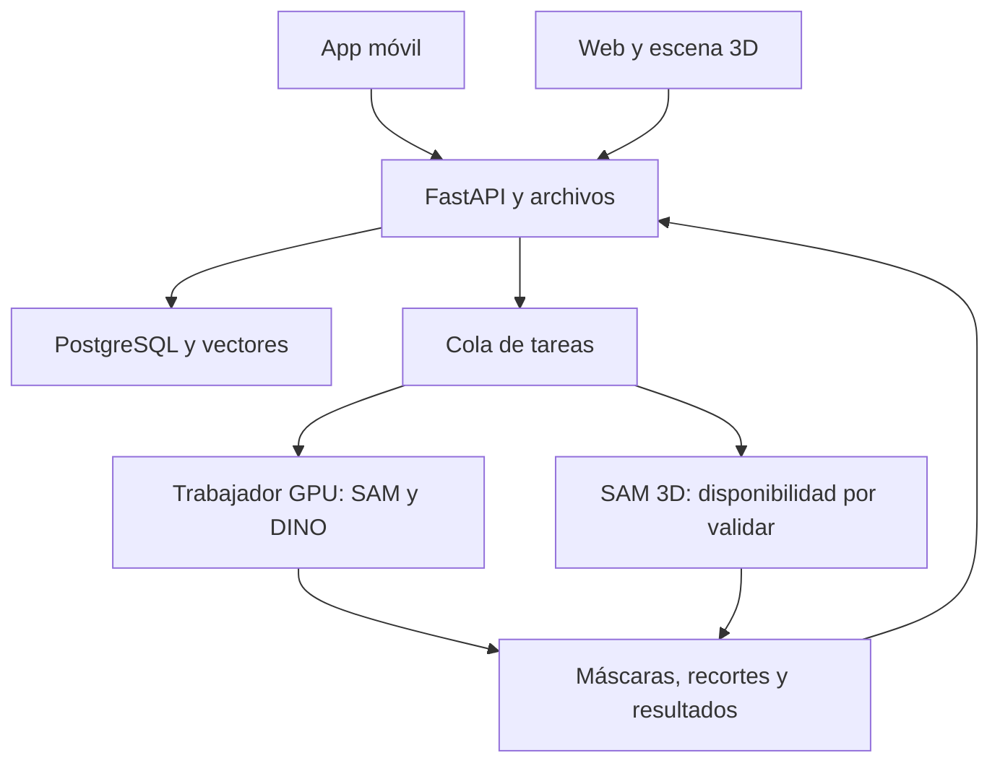

# Asset Finder — Contexto para Claude y el equipo

**Actualizado:** 5 de noviembre de 2026.  
**Repositorio:** https://github.com/Kamus-Ac/Asset-Finder  
**Equipo:** cuatro personas. Los nombres y la asignación final aún deben completarse.  
**Naturaleza:** contexto de producto y propuesta de implementación; no acredita que todas las funciones estén desarrolladas.

## 1. Lectura inicial para Claude

Usa este documento para comprender el objetivo, las restricciones y el reparto propuesto. Antes de modificar código, inspecciona el repositorio y sus instrucciones. Distingue entre avances confirmados, decisiones de producto y propuestas técnicas. No presentes una funcionalidad prevista como terminada ni inventes resultados de pruebas.

Este documento recoge el alcance actualizado: **app móvil + web + servidor de IA**. Reemplaza conceptualmente el plan anterior centrado en búsqueda de archivos locales. No reintroduzcas ese alcance salvo que el equipo lo solicite.

El equipo busca avanzar por entregables pequeños, con pasos claros, pruebas y explicaciones en español. Las decisiones aún abiertas se listan al final.

## 2. Idea y objetivo del producto

Asset Finder ayuda a encontrar assets 3D parecidos a un objeto visto en una foto o video. La app permite capturar referencias con la cámara; la web recibe archivos. En ambas se selecciona el objeto y se consulta un catálogo visual. Se quiere ofrecer también reconstrucción 3D desde la referencia. En la web, el usuario podrá colocar modelos en un ambiente virtual.

**Primer recorrido integrado:** tomar una foto desde el celular → seleccionar una silla → obtener modelos similares → guardar una elección en un proyecto → abrirla en la web → colocarla en una escena y guardar la composición.

La plataforma consulta las fuentes del catálogo que estén conectadas e indexadas. No se promete buscar todos los assets de internet.

## 3. Alcance actualizado

| Funcionalidad | App móvil | Web | Estado de definición |
| --- | --- | --- | --- |
| Tomar fotografías y grabar video | Sí | No es requisito; se suben archivos | Definido |
| Adjuntar imagen o video | Sí, previsto como complemento de cámara | Sí | Definido |
| Elegir fotograma de video | Sí | Sí | Solución inicial propuesta |
| Seleccionar objeto y revisar máscara | Sí | Sí | Definido |
| Buscar assets similares | Sí | Sí | Definido |
| Solicitar reconstrucción 3D | Sí | Pendiente confirmar disponibilidad en web | Objetivo condicionado a viabilidad técnica |
| Compartir proyectos y modelos elegidos | Sí | Sí | Propuesta de integración entre clientes |
| Arrastrar y editar modelos en una escena | No requerido inicialmente | Sí | Definido para web |
| Guardar y recuperar escenas | No requerido inicialmente | Sí | Entregable propuesto |
| Buscar carpetas del dispositivo | Fuera de alcance | Fuera de alcance | Descartado por el usuario |
| Ejecutar modelos de IA en el cliente | No | No | Descartado por el usuario |

**Importante:** que el servidor sea una laptop del equipo no convierte el producto en una aplicación local. Los clientes envían solicitudes al servidor.

La búsqueda por texto y dino.txt pertenecen a propuestas anteriores y no son prioridad del nuevo MVP. Realidad aumentada, rigging, físicas y edición profesional de mallas tampoco están comprometidos.

## 4. Restricciones y recursos confirmados

- Solo se pueden utilizar **modelos de IA de Meta**. Las bibliotecas, frameworks y herramientas pueden ser de otros proveedores.
- Servidor previsto: laptop con RTX 4070 Laptop, **8 GB de VRAM y 16 GB de RAM**.
- Tailscale se usará para conectar los dispositivos al servidor.
- Entorno anterior: Windows con Ubuntu en WSL2, Python 3.11 y Node mediante nvm.
- El sistema operativo y la configuración GPU definitivos de la laptop servidor deben verificarse; no asumir que ya están desplegados.
- SAM y DINO se deben probar con CUDA en el servidor. La instalación anterior de PyTorch era para CPU.
- Presupuesto, fecha límite, sistema operativo móvil definitivo y número de usuarios concurrentes no están confirmados.

### Límite de la reconstrucción 3D

SAM 3D Objects es el candidato de Meta. La documentación oficial revisada anteriormente indica Linux de 64 bits y una GPU NVIDIA con al menos 32 GB de VRAM. La laptop disponible no cumple esa configuración.

Esto es una dependencia técnica abierta: investigar una ejecución de menor memoria o hardware adicional, medirla y decidir. No garantizar que funcionará con 8 GB ni tratar RAM y VRAM como memoria intercambiable. Antes de instalar, volver a revisar las instrucciones y licencias actuales.

La generación forma parte del objetivo de producto, pero su implementación operativa está condicionada a la validación. La búsqueda y la escena deben poder completarse usando modelos del catálogo.

## 5. Stack tecnológico y uso

El siguiente es el **stack objetivo propuesto**, pendiente de contrastar con los archivos reales del repositorio y fijar versiones compatibles.

| Capa | Tecnología | Uso | Responsable principal |
| --- | --- | --- | --- |
| Móvil | React Native + Expo + TypeScript | Cámara, archivos, selección y resultados | P1 |
| Captura móvil | Módulos de cámara y archivos compatibles con Expo | Permisos, fotos, videos y galería | P1 |
| Web | React + TypeScript + Vite | Búsqueda, proyectos y navegación | P2 |
| Estilos web | Tailwind CSS | Interfaz adaptable | P2 |
| Selección visual | Gestos en móvil; Canvas o superposición en web | Rectángulo, puntos y máscara | P1/P2 |
| Escena web | Three.js + React Three Fiber; controles compatibles | Cargar GLB, selección, cámara y transformaciones | P2 |
| API | Python + FastAPI + Uvicorn | Contratos, archivos, proyectos y tareas | P3 |
| Validación API | Esquemas Pydantic y python-multipart | Entradas y carga multipart | P3 |
| Base de datos | PostgreSQL | Usuarios/proyectos si se incluyen cuentas, assets, tareas y escenas | P3 |
| Búsqueda vectorial | pgvector, con referencia NumPy para pruebas | Índice y similitud entre embeddings | P3/P4 |
| Procesamiento | Redis + RQ como opción inicial | Cola y trabajador; una tarea GPU a la vez | P3 |
| Archivos | Disco administrado por el servidor al comenzar; S3 compatible si se necesita | Capturas, máscaras, miniaturas y modelos | P3 |
| Red | Tailscale; Serve para acceso privado | Conectar clientes autorizados con API/archivos | P3 |
| Inferencia | PyTorch con CUDA | Ejecutar los modelos en NVIDIA | P4/P3 |
| Segmentación | SAM 2.1 Tiny | Objeto señalado → máscara | P4 |
| Representación visual | DINOv2 ViT-S/14 inicialmente | Imagen → embedding visual | P4 |
| Reconstrucción | SAM 3D Objects | Imagen y máscara → representación 3D exportable, por validar | P4 |
| Preparación de imágenes | Pillow + NumPy | Recortes, composición RGB, máscaras y normalización | P4 |
| Video | FFmpeg | Metadatos y fotogramas | P4/P3 |
| Preparación del catálogo | Blender en segundo plano cuando sea necesario | Renderizar vistas de assets y preparar formatos | P4 |
| Desarrollo | Git/GitHub, VS Code, uv, npm | Colaboración y dependencias reproducibles | Todos |

No es obligatorio montar un servicio S3, un segundo índice FAISS o contenedores para completar la primera prueba. Elegir una solución por responsabilidad y documentarla. Si se usa pgvector, no introducir además otro buscador vectorial sin una necesidad medida.

## 6. Arquitectura lógica propuesta



Tailscale transporta el acceso de los dispositivos autorizados a los servicios publicados; no aporta memoria ni ejecuta IA. El navegador y el celular reciben datos y archivos; nunca credenciales directas de la base de datos.

**Acceso inicial:** pruebas privadas con los dispositivos del equipo en Tailscale. El acceso para público sin Tailscale exige otra decisión: entrada pública protegida o backend público conectado privadamente a la laptop. Tailscale Serve privado no equivale a publicación pública. Las URLs de API, miniaturas y modelos deben ser accesibles para el cliente correspondiente.

## 7. Cómo funciona el sistema

### 7.1 Indexar el catálogo en el servidor

1. Incorporar assets o fuentes autorizadas con identificador, metadatos y enlaces.
2. Conservar el modelo 3D cuando esté disponible para su uso; una página externa no garantiza que pueda descargarse o mostrarse en la escena.
3. Obtener varias vistas previas. Si tenemos el archivo, Blender puede renderizarlas con encuadre y fondo consistentes.
4. Procesar cada vista con DINO, normalizar sus vectores y guardarlos con el identificador del asset y de la versión de índice.
5. Registrar archivos nuevos/modificados, errores y modelos con texturas faltantes.
6. Reindexar únicamente lo que cambie.

El catálogo inicial puede ser curado manualmente para validar el producto antes de conectar fuentes externas. La indexación ocurre en el servidor, no en carpetas del usuario.

### 7.2 Buscar desde imagen o video

1. Capturar en móvil o cargar archivo en web/móvil.
2. Normalizar orientación; para video seleccionar un fotograma y guardar su posición temporal.
3. Dibujar un rectángulo y opcionalmente puntos positivos/negativos sobre la imagen.
4. Convertir las coordenadas de la vista a la imagen real que procesará el backend.
5. SAM genera máscara; el usuario puede revisarla y corregirla.
6. Preparar el recorte y componer un fondo RGB consistente para DINO.
7. DINO produce un embedding de consulta.
8. Comparar con los vectores ya indexados, agrupar las vistas por asset y ordenar resultados.
9. Devolver miniatura, nombre, puntuación, origen y disponibilidad del archivo 3D.
10. Guardar las elecciones en un proyecto compartido con la web.

DINO procesa la apariencia, no los metadatos del archivo. No lee directamente la geometría GLB/FBX. PyTorch ejecuta el modelo; la comparación puede hacerla NumPy o pgvector. Los vectores internos de SAM no se sustituyen directamente por embeddings de DINO.

Los vectores del catálogo no se recalculan en cada consulta. Un recorte nuevo pasa por DINO una vez; su vector puede cachearse. Cambiar selección, pesos o preparación puede requerir recalcularlo. Guardar siempre modelo, pesos y configuración de preparación del índice.

La similitud es una puntuación de ranking, no un porcentaje garantizado de acierto.

### 7.3 Reconstruir un objeto

1. El usuario solicita reconstrucción de una selección revisada.
2. El backend comprueba disponibilidad del servicio y crea una tarea.
3. El trabajador recibe imagen, máscara y configuración.
4. Si SAM 3D es viable, genera la salida; se valida la exportación a un formato que soporte el visor.
5. Se registra resultado o error; el cliente consulta el estado.
6. El modelo listo puede asociarse a un proyecto y colocarse en la escena web.

No asumir que SAM 3D devuelve automáticamente el GLB requerido por la aplicación. Validar representación de salida, conversión y texturas. La reconstrucción puede necesitar corrección manual y no garantiza topología, rigging ni calidad lista para juegos.

Si el servicio no está disponible, informarlo explícitamente. No mostrar resultados de ejemplo como si fueran una generación real.

### 7.4 Colocar modelos en el ambiente virtual

1. Abrir un proyecto en la web y seleccionar un modelo disponible.
2. Cargarlo y arrastrarlo a un punto sobre el piso; convertir el puntero en coordenadas de escena.
3. Mover, rotar, escalar, duplicar o eliminar instancias según el alcance acordado.
4. Guardar referencias a los assets y transformaciones de cada instancia.
5. Recuperar la composición al volver a abrir el proyecto.

MVP de escena: piso, cuadrícula, cámara, iluminación, selección y controles de transformación. No incluye por defecto AR, físicas ni una herramienta profesional de modelado.

## 8. Equipo y responsables

La asignación es una **propuesta**, no un reparto nominal confirmado. Completar nombres al acordarlo.

| Rol | Nombre | Propiedad principal | Apoyo |
| --- | --- | --- | --- |
| P1 — App móvil | Por asignar | Captura, navegación, selección y consulta móvil | P3 contratos; P4 selección |
| P2 — Web y escena 3D | Por asignar | Búsqueda web, editor y persistencia visual de escenas | P3 guardado; P4 assets |
| P3 — Backend y servidor | Por asignar | API, datos, archivos, tareas, despliegue y Tailscale | P4 GPU; P1/P2 integración |
| P4 — IA y catálogo | Manuel sugerido, por confirmar | SAM, DINO, indexación y evaluación de SAM 3D | P3 ejecución; P2 renders |

### P1 — Qué aprender, implementar y entregar

**Aprender:** componentes/estado de React Native, TypeScript, navegación, permisos de cámara/galería, envío multipart, HTTP, coordenadas y gestos, consulta de tareas.

**Implementar:** captura/carga y previsualización; selección revisable; resultados y detalle; proyectos/modelos elegidos; solicitud de reconstrucción con estados reales; errores de red/permisos y reintentos controlados.

**Entregable:** recorrido móvil probado en un teléfono real, con la API compartida. No necesita ejecutar los modelos localmente.

### P2 — Qué aprender, implementar y entregar

**Aprender:** React, TypeScript, Tailwind, carga de archivos y Canvas; Three.js/R3F, cámara, raycasting, GLB, transformaciones y serialización de escena.

**Implementar:** búsqueda desde archivos, selección/máscara, catálogo, carga 3D bajo demanda, arrastre al piso, selección/mover/rotar/escalar/eliminar y guardar/recuperar escena.

**Entregable:** una escena persistente con varios objetos, integrada con resultados reales y con manejo de archivos no disponibles.

### P3 — Qué aprender, implementar y entregar

**Aprender:** FastAPI, validación, HTTP/JSON, base de datos y migraciones, carga/entrega de archivos, permisos por proyecto, colas y estados, Linux/WSL, procesos, Tailscale y diagnóstico GPU con P4.

**Implementar:** contratos tempranos y respuestas de prueba; capturas/proyectos/assets/escenas; almacenamiento; cola con concurrencia GPU uno; integración IA; API accesible por la red acordada; registros y guía de reinicio.

**Entregable:** servicios accesibles desde los dos clientes, datos consistentes y procesamiento recuperable ante errores. Si se incluyen cuentas, resolver autenticación y autorización del proyecto.

### P4 — Qué aprender, implementar y entregar

**Aprender:** PyTorch/CUDA, memoria GPU, SAM y prompts, DINO/embeddings, similitud coseno, normalización, renderizado con Blender y evaluación de recuperación.

**Implementar:** funciones reutilizables de segmentación; preparación del recorte; indexador del catálogo; ranking agrupado por asset; caché/versionado; extracción de fotogramas; mediciones y prueba acotada de SAM 3D.

**Entregable:** búsqueda medible y reproducible, interfaces estables para el trabajador y conclusión documentada sobre generación 3D.

**Compartido:** Git, PRs, lectura de errores, documentación y pruebas cruzadas. P3 y P4 no deben convertirse en una sola dependencia bloqueante: P1/P2 trabajan con contratos y respuestas de ejemplo desde la primera semana.

## 9. Roadmap de seis semanas orientativas

No representa fecha límite confirmada. Ajustar al calendario real.

| Semana | P1 móvil | P2 web/3D | P3 backend/servidor | P4 IA/catálogo | Hito integrado |
| --- | --- | --- | --- | --- | --- |
| 1 | Navegación y pantallas con ejemplos | Pantallas y escena con GLB de prueba | API base, contratos y ejemplos; revisar servidor | Medir SAM/DINO en GPU; conjunto de pruebas | Clientes consumen respuestas acordadas |
| 2 | Cámara, galería, permisos y subida | Carga GLB, cámara, piso y cuadrícula | Archivos, proyectos y acceso Tailscale | Segmentación reusable y preparación de imagen | Captura real llega al servidor |
| 3 | Rectángulo, máscara y correcciones | Transformaciones y selección visual | Trabajador GPU y estados de tareas | Catálogo de 20–50 modelos indexado | Selección real e índice consultable |
| 4 | Búsqueda real y resultados | Catálogo real y arrastre a escena | Integrar búsquedas y entrega de modelos | Ranking y evaluación de relevancia | Foto → búsqueda → modelo en escena |
| 5 | Guardar elecciones; tareas de generación si disponibles | Guardar/recuperar composición | Persistencia de escenas y servicio de generación condicionado | Caché/video; prueba de SAM 3D | Continuidad móvil-web |
| 6 | Pruebas en teléfono, errores y experiencia | Rendimiento y recuperación de errores | Arranque repetible y pruebas integradas | Medición final y documentación | Demo reproducible de extremo a extremo |

**Investigación temprana de SAM 3D:** iniciar la comprobación de hardware y dependencias en semanas 1–2, con tiempo acotado. No esperar a la semana 5 para descubrir si es viable. Integrar la interfaz de tareas independientemente, sin afirmar que ya existe el generador.

### Orden de prioridad

- **P0:** catálogo pequeño real, selección, búsqueda, acceso móvil/web, modelos disponibles y escena básica guardable.
- **P1:** video por fotograma, correcciones de máscara, filtros, caché y robustez.
- **P1 condicionado:** reconstrucción SAM 3D, tras superar prueba de viabilidad.
- **P2:** conectores externos adicionales, escena avanzada y búsqueda textual, si el equipo los aprueba.

## 10. Contratos de integración propuestos

Estos endpoints y campos son un borrador a acordar; no se afirma que existan.

| Operación | Endpoint orientativo | Salida |
| --- | --- | --- |
| Estado básico | `GET /health` | Salud de API; disponibilidad GPU en diagnóstico separado |
| Subir referencia | `POST /media` | ID, tipo y dimensiones normalizadas |
| Fotogramas | `POST /media/{id}/frames` | Tarea o lista de cuadros accesibles |
| Segmentar | `POST /segmentations` | ID de tarea |
| Consultar tarea | `GET /tasks/{id}` | Estado, resultado/error y etapa |
| Buscar por selección | `POST /searches` | Resultados o ID de tarea, decisión a fijar |
| Solicitar reconstrucción | `POST /generations` | Tarea o respuesta explícita de servicio no disponible |
| Consultar asset | `GET /assets/{id}` | Metadatos y disponibilidad de archivo |
| Gestionar proyectos | `/projects` | Proyectos y elecciones |
| Guardar escena | `PUT /projects/{id}/scene` | Versión y composición persistida |

Selección orientativa, en coordenadas de la imagen normalizada:

```json
{
  "media_id": "media_example",
  "frame_id": null,
  "image_width": 1200,
  "image_height": 900,
  "box_xyxy": [100, 80, 1000, 850],
  "points": [{"x": 500, "y": 400, "label": 1}]
}
```

`label: 1` incluye y `label: 0` excluye. Validar rangos, orden del rectángulo, orientación y pertenencia del archivo al proyecto.

Resultado orientativo:

```json
{
  "asset_id": "asset_example",
  "name": "Silla de ejemplo",
  "thumbnail_url": "/files/preview_example.png",
  "similarity_score": 0.82,
  "source": "curated_catalog",
  "source_url": null,
  "license": null,
  "model_available": true,
  "model_url": "/files/model_example.glb",
  "format": "glb"
}
```

Los valores son ejemplos de contrato, no datos reales. `model_available: false` debe impedir ofrecer arrastre funcional de un archivo inexistente. Campos desconocidos permanecen vacíos, no se inventan.

Estados propuestos de tarea: `queued`, `running`, `completed`, `failed`, y `cancelled` solo si se implementa cancelación. El progreso porcentual se muestra únicamente cuando pueda medirse; en otro caso usar etapas.

Para escena: convención inicial Y hacia arriba, escala del editor documentada y rotación con representación/unidades fijas. Guardar `asset_id`, `instance_id`, posición, rotación y escala; una escena puede contener varias instancias del mismo asset. No asumir medidas físicas reales si el modelo no aporta escala válida.

## 11. Recursos y operación del servidor

- Una tarea GPU activa inicialmente; poner el resto en cola.
- Medir memoria máxima, RAM, carga y tiempos por etapa.
- Mantener embeddings del catálogo precomputados y limitar cargas repetidas de modelos.
- No exigir a móvil/web descargar pesos ni instalar Python/CUDA.
- Limitar tamaño, duración y resolución de entradas tras medición.
- Separar errores de red, archivo, importación, memoria y modelo no disponible.
- Mantener la laptop conectada, encendida y sin suspensión durante las pruebas del servicio.
- No aplicar sin cambios el instalador anterior de CPU a la configuración CUDA del servidor.

## 12. Estado confirmado y antecedentes útiles

**Confirmado por pruebas compartidas:** Ubuntu instalado; entorno SAM separado; SAM 2.1 Tiny cargado en CPU; segmentación de una silla correcta usando un rectángulo. Un punto central había seleccionado solo una tabla del respaldo.

La salida anterior indicó PyTorch `2.15.0+cpu`; es un registro de aquella instalación, no una versión obligatoria para CUDA. Un FutureWarning de torch.jit no impidió cargar SAM.

**No confirmado:** despliegue GPU, Tailscale operativo, búsqueda DINO completa, catálogo indexado, app móvil, editor web integrado, base de datos compartida y reconstrucción 3D. La recepción de instrucciones o scripts no demuestra su instalación exitosa. No se ha inspeccionado en esta actualización el código remoto vigente.

Estructura de trabajo anterior conocida:

```text
asset-finder/
  frontend/
  backend/
  ai/
    .venv-sam2/
    sam2/
    prueba_sam2.py
```

La carpeta móvil, el trabajador y la documentación podrán incorporarse; inspeccionar antes de reorganizar. El script de prueba ubicado junto al repositorio SAM produjo un conflicto de importación; se resolvió ejecutando desde `ai/sam2` con `python -P ../prueba_sam2.py`. Conviene corregir el empaquetado al integrar el servicio.

Se produjo un conflicto de TypeScript de la plantilla y se indicó usar 5.9.3. Verificar `package.json` y el lockfile actual antes de imponer versiones. El instalador `Instalar-Asset-Finder.ps1` previo preparaba la versión de desarrollo CPU, no este despliegue completo.

## 13. Git y forma de trabajo

Repositorio: https://github.com/Kamus-Ac/Asset-Finder

- Una rama por tarea, por ejemplo `feature/mobile-capture`, `feature/web-scene`, `feature/task-api`, `feature/visual-search`.
- Pull Request con descripción, validación y limitaciones conocidas.
- Integrar avances pequeños al menos semanalmente; probar el recorrido completo entre áreas.
- Mantener `package-lock.json`, dependencias Python y commits/pesos de modelos documentados.
- No subir node_modules, entornos virtuales, pesos, capturas privadas, claves, archivos .env ni grandes resultados generados.
- Mantener `.env.example` con nombres de variables y valores de ejemplo sin secretos.
- Cada responsable deja comandos de arranque, configuración necesaria y una prueba de su módulo.
- Los cambios de contrato se acuerdan con sus consumidores y actualizan ejemplos/documentación.

## 14. Definición de terminado y pruebas

Una función está terminada cuando funciona con el servidor real, maneja errores esperados y puede probarla otro integrante siguiendo instrucciones.

| Área | Validación mínima |
| --- | --- |
| Móvil | Foto real, permisos rechazados, selección correcta y consulta desde otro dispositivo |
| Web | Subida, máscara, resultados, GLB disponible y escena recuperada tras recargar |
| Backend | Archivos válidos/inválidos, estados persistidos y proyectos aislados si hay usuarios |
| IA | Referencias conocidas, ranking agrupado por asset, máscara revisable y tiempos/VRAM medidos |
| Cola | Dos solicitudes simultáneas esperan turno; un fallo no bloquea las siguientes |
| Reconstrucción | Archivo real generado, exportación válida, visualización y consumo medidos antes de declararla disponible |

Medir relevancia con consultas y coincidencias conocidas, y consultas sin coincidencia clara. No prometer umbrales, latencia o calidad sin resultados. Probar redes y la accesibilidad real de URLs de archivos desde móvil y web.

## 15. Decisiones que el equipo debe cerrar

1. Nombres de P1–P4 y asignación final; Manuel en IA es solo sugerencia.
2. Android inicialmente o también iOS.
3. Acceso privado Tailscale para demo o acceso público posterior.
4. Fuente y licencias del catálogo, cantidad inicial y archivos realmente disponibles.
5. Cuentas de usuario o un modo de demostración limitado; mecanismo de autenticación.
6. Confirmar PostgreSQL/pgvector, cola y almacenamiento antes de implementarlos.
7. Posibilidad de generación en web además de móvil.
8. Viabilidad de SAM 3D con el hardware actual o alternativa de infraestructura aprobada.
9. Límites de carga y de escena; fecha real de entrega.
10. Convenciones de unidades, coordenadas y esquema de persistencia.

## 16. Fuentes oficiales para verificar al implementar

- SAM 2: https://github.com/facebookresearch/sam2
- DINOv2 y dino.txt: https://github.com/facebookresearch/dinov2
- SAM 3D Objects: https://github.com/facebookresearch/sam-3d-objects
- Requisitos SAM 3D: https://github.com/facebookresearch/sam-3d-objects/blob/main/doc/setup.md
- PyTorch: https://pytorch.org/get-started/locally/
- Expo: https://docs.expo.dev/
- React Three Fiber: https://r3f.docs.pmnd.rs/
- FastAPI: https://fastapi.tiangolo.com/
- pgvector: https://github.com/pgvector/pgvector
- RQ: https://python-rq.org/
- Tailscale: https://tailscale.com/docs/

Las referencias permiten revisar requisitos, compatibilidad y condiciones actuales; no sustituyen las mediciones en la laptop ni la inspección del repositorio.
